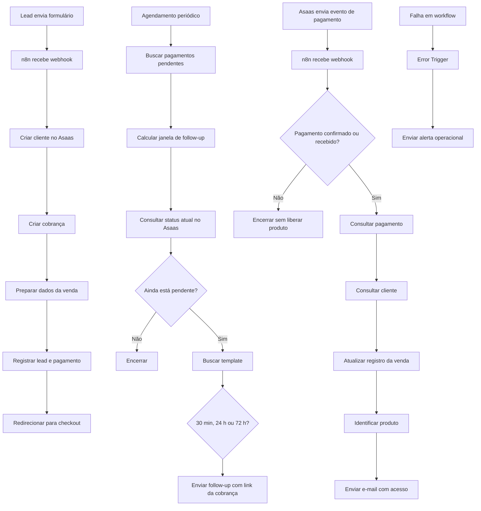

# Automação de jornada de compra, recuperação de pagamento e entrega com n8n

## Visão rápida

**Contexto:** automação de uma jornada comercial real, conectando formulário de entrada, cobrança, acompanhamento de pagamento, recuperação de clientes, atualização de lead, entrega digital e monitoramento de falhas.

**Problema:** o processo exigia várias etapas manuais entre captar o lead, criar a cobrança, acompanhar o status do pagamento, recuperar quem não concluiu a compra, atualizar os dados comerciais e entregar o produto correto após a confirmação.

**Minha atuação:** desenho do fluxo, definição das regras de negócio, integração entre sistemas, configuração dos workflows no n8n, testes e acompanhamento do comportamento em produção.

**Resultado:** o processo passou a executar automaticamente a criação da cobrança, o registro do lead, a recuperação de pagamentos pendentes, a confirmação financeira, a atualização do registro e a entrega do produto, reduzindo dependência de execução manual e risco de falhas operacionais.

---

## O problema

Uma venda digital parecia simples na superfície, mas envolvia várias operações diferentes:

1. receber os dados do interessado;
2. criar o cliente no meio de pagamento;
3. gerar a cobrança;
4. direcionar a pessoa para o pagamento;
5. registrar os dados comerciais;
6. acompanhar se o pagamento foi confirmado;
7. recuperar quem não concluiu a compra;
8. atualizar o status da venda;
9. entregar automaticamente o produto correto;
10. monitorar falhas nos próprios workflows.

Quando essas etapas dependem de acompanhamento manual, surgem riscos de atraso, erro de registro, perda de lead, cobrança não acompanhada e entrega inconsistente.

O objetivo da automação foi transformar esse processo em um fluxo rastreável, orientado por eventos e com recuperação automática de oportunidades.

---

## Arquitetura do fluxo

A solução foi dividida em workflows com responsabilidades diferentes: **entrada e cobrança**, **recuperação de não pagamento**, **confirmação e entrega** e **monitoramento de erros**.

---

## 1. Entrada do lead e criação da cobrança

O primeiro workflow é acionado por webhook quando a pessoa envia o formulário.

A partir daí, o n8n:

- recebe os dados do lead;
- cria o cliente no Asaas via API;
- cria a cobrança correspondente ao produto;
- organiza os dados retornados pela API;
- registra informações comerciais e de pagamento;
- redireciona a pessoa para a URL da cobrança.

A automação mantém no registro informações como identificadores da cobrança, status, cliente, produto, origem e data de criação.

---

## 2. Recuperação automática de não pagamento

Um segundo workflow acompanha cobranças ainda pendentes.

Ele roda periodicamente, busca registros com status **PENDING** e calcula há quanto tempo a cobrança foi criada.

Foram definidas três janelas de contato:

- aproximadamente **30 minutos**;
- aproximadamente **24 horas**;
- aproximadamente **72 horas**.

Antes de enviar qualquer mensagem, o fluxo consulta novamente o Asaas para verificar o status atual da cobrança.

Se o pagamento já deixou de estar pendente, o processo é interrompido.

Se continua pendente, o workflow:

- identifica a janela correta;
- busca o template de comunicação correspondente ao produto e ao momento;
- envia um e-mail de follow-up;
- inclui o link original da cobrança para que o cliente possa retomar a compra.

Essa validação evita enviar mensagens de recuperação para alguém que já pagou.

---

## 3. Confirmação do pagamento

O workflow de confirmação é orientado por eventos do Asaas.

Ele recebe notificações por webhook e processa apenas eventos de pagamento relevantes.

Antes de continuar, o fluxo valida:

- o tipo de evento;
- a existência de uma referência externa para identificar o produto;
- o status efetivo da cobrança.

Somente pagamentos confirmados ou recebidos seguem para a etapa de entrega.

---

## 4. Consulta e atualização dos dados

Após a confirmação, o fluxo consulta novamente a API do Asaas para recuperar os dados atuais da cobrança e do cliente.

Com isso, o registro comercial é atualizado com o estado consolidado da venda, incluindo:

- status;
- identificação da cobrança;
- identificação do cliente;
- produto;
- nome;
- e-mail.

---

## 5. Entrega automática do produto

A referência do produto é usada para localizar a configuração de entrega correspondente.

O conteúdo do e-mail pode ser recuperado de uma tabela de configuração, permitindo variar:

- assunto;
- título;
- corpo;
- link de acesso;
- botão principal;
- links adicionais.

Depois disso, o n8n envia automaticamente o e-mail de boas-vindas e acesso ao produto adquirido.

---

## 6. Monitoramento de falhas

Também existe um workflow separado para monitoramento de erros.

Quando um workflow falha, um **Error Trigger** captura informações da execução, como:

- nome do workflow;
- mensagem de erro;
- último nó executado;
- identificador da execução;
- modo de execução;
- horário;
- link para investigação.

Essas informações são enviadas automaticamente para um canal operacional, permitindo identificar falhas sem depender de inspeção manual constante do n8n.

---

## Decisões importantes

### Pagamento é a fonte da verdade

A entrega não acontece apenas porque uma cobrança foi criada.

O fluxo espera a confirmação do meio de pagamento e valida o status antes de liberar o produto.

### Follow-up só acontece se o pagamento continuar pendente

Antes de cada recuperação, o sistema consulta novamente a cobrança no Asaas.

Isso impede mensagens indevidas para clientes que já concluíram o pagamento.

### Recuperação em momentos diferentes

A estratégia foi dividida em janelas distintas, permitindo adaptar a comunicação ao tempo decorrido desde a criação da cobrança.

### Templates separados da lógica

Os textos de follow-up e entrega são buscados a partir de configurações externas ao fluxo.

Isso facilita reutilização e alteração das comunicações sem reconstruir a automação.

### Monitoramento também faz parte da automação

O fluxo não termina na execução da regra de negócio.

Falhas dos workflows também são capturadas e encaminhadas para investigação.

---

## Tecnologias e integrações

- **n8n**
- **Asaas API**
- **Webhooks**
- **HTTP / REST APIs**
- **JavaScript em nodes de transformação**
- **Google Sheets**
- **SMTP / e-mail transacional**
- **Formulário com envio por webhook**
- **Workflow de error handling / observabilidade**

---

## Minha atuação

Minha atuação esteve no desenho do processo, definição das regras de negócio, configuração dos workflows, integração das APIs e validação do fluxo ponta a ponta.

O trabalho envolveu transformar uma jornada comercial com várias etapas independentes em um processo automatizado capaz de acompanhar a venda desde a entrada do lead até a confirmação financeira, recuperação de pagamentos pendentes e entrega digital.

Também defini os pontos em que o fluxo deveria continuar, interromper, consultar novamente uma fonte externa ou acionar um canal de monitoramento.

---

## O que permanece privado

Este repositório documenta a arquitetura e as decisões do fluxo sem expor dados de produção.

Permanecem privados:

- credenciais;
- tokens e chaves de API;
- IDs internos;
- URLs de webhooks;
- identificadores de planilhas;
- dados de clientes;
- detalhes comerciais sensíveis;
- templates completos de comunicação;
- configurações específicas do ambiente de produção.

---

## Status

O fluxo está em uso real e continua sujeito a melhorias conforme surgem novas regras de negócio e necessidades operacionais.
