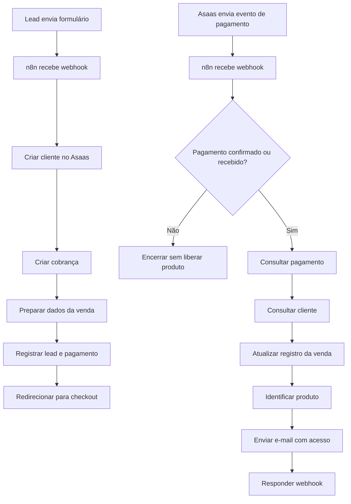

# Automação de jornada de compra e recuperação de pagamento com n8n

## Visão rápida

**Contexto:** automação de uma jornada comercial real, conectando formulário de entrada, cobrança, acompanhamento de pagamento, atualização de lead e entrega digital.

**Problema:** o processo exigia várias etapas manuais entre captar o lead, criar a cobrança, acompanhar o status do pagamento, atualizar os dados comerciais e entregar o produto correto após a confirmação.

**Minha atuação:** desenho do fluxo, definição das regras de negócio, integração entre sistemas, configuração dos workflows no n8n, testes e acompanhamento do comportamento em produção.

**Resultado:** o processo passou a executar automaticamente a criação da cobrança, o registro do lead, o acompanhamento do pagamento e a entrega do produto após confirmação, reduzindo dependência de execução manual e risco de falhas operacionais.

---

## O problema

Uma venda digital parecia simples na superfície, mas envolvia várias operações diferentes:

1. receber os dados do interessado;
2. criar ou registrar o cliente no meio de pagamento;
3. gerar a cobrança;
4. direcionar a pessoa para o pagamento;
5. registrar os dados comerciais;
6. acompanhar se o pagamento foi confirmado;
7. atualizar o status da venda;
8. entregar automaticamente o produto correto.

Quando essas etapas dependem de acompanhamento manual, surgem riscos de atraso, erro de registro, perda de lead e entrega inconsistente.

O objetivo da automação foi transformar esse processo em um fluxo único, rastreável e orientado por eventos.

---

## Arquitetura do fluxo

De forma simplificada:

O fluxo foi dividido em duas partes principais: **entrada e criação da cobrança** e **confirmação e entrega após pagamento**.

---

## 1. Entrada do lead e criação da cobrança

O primeiro workflow é acionado por webhook quando a pessoa envia o formulário.

A partir daí, o n8n:

- recebe os dados do lead;
- cria o cliente no Asaas via API;
- cria a cobrança correspondente ao produto;
- organiza os dados retornados pela API;
- registra informações comerciais e de pagamento;
- redireciona a pessoa para a URL da cobrança.

A automação mantém no registro informações como identificadores da cobrança, status, cliente, produto, origem e data de criação.

Isso permite que as etapas seguintes não dependam de busca manual ou conferência isolada em diferentes ferramentas.

---

## 2. Confirmação do pagamento

O segundo workflow é orientado por eventos do Asaas.

Ele recebe notificações de pagamento por webhook e filtra somente eventos relevantes de confirmação ou recebimento.

Antes de continuar, o fluxo valida:

- o tipo de evento;
- a existência de uma referência externa para identificar o produto;
- o status efetivo da cobrança.

Somente pagamentos confirmados ou recebidos seguem para a etapa de entrega.

Essa regra impede que eventos intermediários liberem um produto antes da confirmação financeira.

---

## 3. Consulta e atualização dos dados

Após a confirmação, o fluxo consulta novamente a API do Asaas para recuperar os dados atuais da cobrança e do cliente.

Com isso, o sistema consegue atualizar o registro comercial com os dados consolidados da venda, incluindo:

- status;
- identificação da cobrança;
- identificação do cliente;
- produto;
- nome;
- e-mail.

Esse passo mantém o acompanhamento comercial sincronizado com o estado real do pagamento.

---

## 4. Entrega automática do produto

A referência do produto é usada para localizar a configuração de entrega correspondente.

O conteúdo do e-mail não fica fixo dentro de cada fluxo. Ele pode ser buscado a partir de uma tabela de configuração, permitindo variar:

- assunto;
- título;
- corpo;
- link de acesso;
- botão principal;
- links adicionais.

Depois disso, o n8n envia automaticamente o e-mail de boas-vindas e acesso ao produto adquirido.

Isso permite que a mesma lógica de automação seja reutilizada para produtos diferentes sem precisar duplicar toda a estrutura do workflow.

---

## Decisões importantes

### Pagamento é a fonte da verdade

A entrega não acontece apenas porque uma cobrança foi criada.

O fluxo espera um evento posterior do meio de pagamento e valida o status antes de liberar o produto.

### Produto identificado por referência externa

A cobrança recebe uma referência que permite ao fluxo saber qual produto foi comprado e recuperar a configuração correta de entrega.

### Registro comercial atualizado automaticamente

Os dados da venda são atualizados a partir do próprio fluxo, reduzindo a necessidade de conferir manualmente formulário, cobrança e entrega em ferramentas diferentes.

### Processamento orientado por eventos

Em vez de consultar constantemente o meio de pagamento, a confirmação chega por webhook.

Isso reduz processamento desnecessário e permite reagir ao evento no momento em que ele acontece.

---

## Tecnologias e integrações

- **n8n**
- **Asaas API**
- **Webhooks**
- **HTTP / REST APIs**
- **JavaScript em nodes de transformação**
- **Google Sheets**
- **SMTP / e-mail transacional**
- **Formulário com envio por webhook**

---

## Minha atuação

Minha atuação esteve no desenho do processo, definição das regras de negócio, configuração dos workflows, integração das APIs e validação do fluxo ponta a ponta.

O trabalho envolveu transformar uma jornada comercial com várias etapas independentes em um processo automatizado capaz de acompanhar a venda desde a entrada do lead até a confirmação financeira e entrega digital.

Também defini os pontos em que o fluxo deveria continuar, interromper ou buscar novas informações antes de executar uma ação.

---

## O que permanece privado

Este repositório documenta a arquitetura e as decisões do fluxo sem expor dados de produção.

Permanecem privados:

- credenciais;
- IDs internos;
- URLs de webhooks;
- identificadores de planilhas;
- dados de clientes;
- detalhes comerciais sensíveis;
- templates completos de comunicação;
- configurações específicas do ambiente de produção.

---

## Status

O fluxo está em uso real e continua sujeito a melhorias conforme surgem novas regras de negócio e necessidades operacionais.
